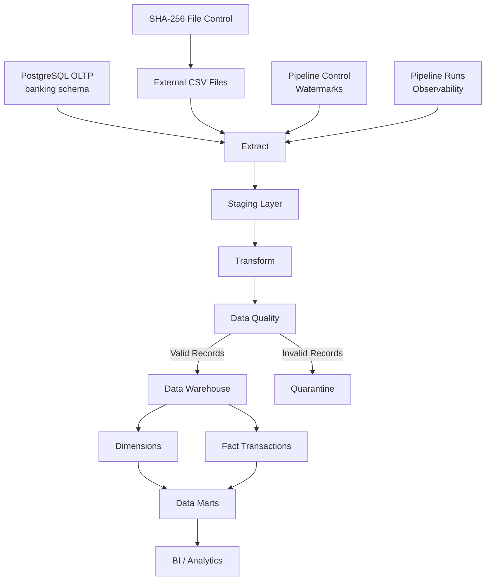

# Bank Data Engineering Lab

A practical end-to-end Data Engineering project that simulates a banking data platform using **Python, PostgreSQL, SQLAlchemy, Pandas and Pytest**.

The project implements ingestion, transformation, data quality validation, incremental processing, dimensional modeling, SCD Type 2, quarantine, observability, idempotency, analytical data marts and automated tests.

The main goal is to demonstrate how transactional banking data can be transformed into reliable, auditable and analytics-ready datasets.

---

## 1. Project Overview

Banking systems generate transactional data continuously from different sources.

A Data Engineering platform must be able to:

- ingest data from multiple sources;
- clean and standardize records;
- detect invalid data;
- preserve rejected records for investigation;
- process only new or modified data when appropriate;
- prevent duplicate processing;
- preserve historical dimensional changes;
- provide operational observability;
- create analytics-ready datasets;
- maintain data integrity;
- support reliable reprocessing.

This project implements these concepts in a local banking laboratory.

---

## 2. Architecture



The architecture separates operational data, processing logic, analytical storage, rejected data and pipeline metadata.

---

## 3. Technology Stack

| Technology | Purpose |
|---|---|
| Python | ETL and pipeline logic |
| PostgreSQL | OLTP, staging, Data Warehouse and marts |
| Pandas | Data transformation |
| SQLAlchemy | Python/PostgreSQL integration |
| psycopg2 | PostgreSQL database driver |
| python-dotenv | Environment configuration |
| Pytest | Automated testing |
| Git | Version control |

Development environment used for the current project:

- Python 3.14
- PostgreSQL 16

---

## 4. Repository Structure

```text
bank_data_engineering_lab/
│
├── data/
│   └── transacoes_externas.csv
│
├── sql/
│   ├── 01_create_oltp_schema.sql
│   ├── 02_create_dw_schema.sql
│   ├── 03_create_etl_control.sql
│   ├── 04_create_observability.sql
│   └── 05_create_data_marts.sql
│
├── src/
│   ├── database.py
│   ├── extract.py
│   ├── transform.py
│   ├── data_quality.py
│   ├── load.py
│   ├── pipeline_control.py
│   ├── pipeline.py
│   ├── external_pipeline.py
│   └── file_control.py
│
├── tests/
│   ├── test_transform.py
│   ├── test_data_quality.py
│   └── test_database_integration.py
│
├── .gitignore
├── requirements.txt
└── README.md
```

---

## 5. Data Layers

The PostgreSQL environment is organized into separate schemas.

### `banking`

Represents the transactional OLTP source system.

Main entities include:

- customers;
- accounts;
- transactions;
- cards;
- credit products.

### `staging`

Temporary landing layer used during ETL processing.

It separates extracted source data from the analytical model.

### `dw`

Dimensional Data Warehouse containing dimensions and transaction facts.

### `etl`

Operational metadata used for:

- pipeline state;
- watermarks;
- execution history;
- quarantine;
- processed-file control.

### `mart`

Analytics-ready datasets designed for BI and reporting.

---

## 6. ETL Pipeline

The main processing flow follows:

```text
EXTRACT
   ↓
STAGING
   ↓
TRANSFORM
   ↓
DATA QUALITY
   ↓
 ┌───────────────┐
 │               │
VALID          INVALID
 │               │
 ▼               ▼
DATA           QUARANTINE
WAREHOUSE
 │
 ▼
DATA MARTS
```

The project is closer to an **ETL architecture** because transformation and validation occur before data is loaded into the final Data Warehouse structures.

---

## 7. Data Transformation

The transformation layer standardizes source data before validation and loading.

Examples include:

```text
" credito "    → "CREDITO"
" processada " → "PROCESSADA"
" luanda "     → "LUANDA"
```

Dates are converted using Pandas datetime conversion.

Invalid dates are converted to `NaT`.

Invalid numeric values are converted to `NaN`.

This allows the Data Quality layer to identify malformed records instead of silently replacing them with invented values.

---

## 8. Incremental Loading

The transaction pipeline does not need to reload the complete source table on every execution.

Incremental extraction uses a **composite watermark** based on:

```text
(updated_at, transacao_id)
```

Conceptually:

```sql
WHERE
    updated_at > :watermark_temporal
    OR (
        updated_at = :watermark_temporal
        AND transacao_id > :watermark_id
    )
ORDER BY
    updated_at,
    transacao_id;
```

### Why two columns?

Using only `transacao_id` would detect newly inserted transactions but could miss updates to older transactions.

`updated_at` detects modifications.

`transacao_id` acts as a deterministic tie-breaker when multiple records have the same timestamp.

The watermark is advanced only after successful processing.

---

## 9. Event Time vs Processing Metadata

Two different timestamps have different responsibilities.

### `data_transacao`

Represents when the business event occurred.

It is used for analytical and temporal dimensional logic.

### `updated_at`

Represents when the source record was technically modified.

It is used for incremental extraction.

Keeping these concepts separate prevents business time from being confused with pipeline processing state.

---

## 10. Slowly Changing Dimension Type 2

Customer history is preserved using **SCD Type 2**.

Instead of overwriting historical customer attributes, a change creates a new dimensional version.

Example:

```text
cliente_id = 3

Version 1
province = BENGUELA
current = FALSE

Version 2
province = HUAMBO
current = TRUE
```

Typical SCD2 fields include:

```text
data_inicio
data_fim
atual
```

A partial unique index protects the rule that each customer can have only one current version.

Historical transaction lookup uses the transaction business timestamp to locate the dimensional version that was valid when the transaction occurred.

---

## 11. Data Quality

Transactions are validated before entering the Data Warehouse.

Examples of validation rules include:

- account must exist;
- transaction amount must be positive;
- transaction type must be valid;
- transaction status must be valid;
- transaction date must be valid;
- `updated_at` must be valid.

Examples of error codes:

```text
MISSING_ACCOUNT
INVALID_ACCOUNT
ACCOUNT_NOT_FOUND

MISSING_AMOUNT
INVALID_AMOUNT

MISSING_TRANSACTION_TYPE
INVALID_TRANSACTION_TYPE

MISSING_STATUS
INVALID_STATUS

INVALID_TRANSACTION_DATE
INVALID_UPDATED_AT
```

A single record can contain multiple validation errors.

For example:

```text
ACCOUNT_NOT_FOUND|INVALID_AMOUNT|INVALID_STATUS
```

This provides more useful diagnostic information than stopping validation after the first error.

---

## 12. Data Quality Invariant

The classifier protects the following invariant:

```text
input records
=
valid records
+
rejected records
```

For example:

```text
100 input
85 valid
15 rejected
-----------
100 classified
```

If records disappear during classification, the pipeline raises an error.

This prevents silent data loss.

---

## 13. Quarantine

Invalid records are not silently discarded.

They are stored in a quarantine structure containing information such as:

- transaction identifier;
- error code;
- error message;
- pipeline run;
- quarantine timestamp;
- original record representation.

Conceptually:

```text
Source
   ↓
Data Quality
   │
   ├── Valid ──────► Data Warehouse
   │
   └── Invalid ────► Quarantine
```

Quarantine allows rejected records to be audited, investigated and potentially corrected or reprocessed later.

---

## 14. Idempotency

A reliable data pipeline should tolerate retries without creating duplicate business records.

The transaction fact uses the business transaction identifier together with an UPSERT strategy.

Conceptually:

```sql
INSERT ...
ON CONFLICT (transacao_id)
DO UPDATE ...
```

Therefore, reprocessing the same transaction does not create another fact row for the same `transacao_id`.

This is especially important when a pipeline fails after data has already been written but before metadata is finalized.

---

## 15. External File Processing

The project also contains a CSV ingestion pipeline.

File processing uses **SHA-256 content hashing**.

Instead of asking only:

> What is the filename?

the pipeline asks:

> Has this exact file content already been successfully processed?

Conceptually:

```text
CSV
 ↓
SHA-256
 ↓
file hash
 ↓
processed_file
 ↓
Already processed?
   │
   ├── YES → skip
   │
   └── NO  → process
```

If a file keeps the same name but its content changes, the SHA-256 hash also changes and the new content can be processed.

---

## 16. Watermark vs File Hash

The project demonstrates two different incremental/idempotency strategies.

### Database source

Uses:

```text
(updated_at, transacao_id)
```

The question is:

> Which database records changed since the previous successful execution?

### File source

Uses:

```text
SHA-256
```

The question is:

> Has this exact file content already been processed?

These mechanisms solve related but different ingestion problems.

---

## 17. Pipeline Observability

Pipeline executions are recorded for operational visibility.

Execution metadata includes concepts such as:

- pipeline name;
- start time;
- end time;
- status;
- extracted rows;
- valid rows;
- rejected rows;
- loaded rows;
- start watermark;
- end watermark;
- error information.

The project distinguishes between:

### Pipeline control

Represents the current processing state.

It answers:

> Where should the next execution continue?

### Pipeline run history

Represents historical executions.

It answers:

> What happened during a specific execution?

---

## 18. Pipeline Status

Executions can have statuses such as:

```text
RUNNING
SUCCESS
SUCCESS_WITH_REJECTIONS
FAILED
```

### SUCCESS

The pipeline completed successfully without rejected records.

A successful execution with zero new source rows is still a successful execution.

### SUCCESS_WITH_REJECTIONS

The pipeline completed technically, but some invalid source records were quarantined.

### FAILED

An unexpected technical failure occurred.

The incremental watermark is not advanced after a failed execution.

---

## 19. Data Warehouse

The analytical model contains:

```text
dw.dim_cliente
dw.dim_conta
dw.dim_tempo
dw.fact_transacao
```

The fact table references dimensions through surrogate keys.

Conceptually:

```text
             dim_cliente
                  │
                  │
dim_conta ── fact_transacao ── dim_tempo
```

The transaction fact contains measures and transaction attributes, while descriptive context is provided by dimensions.

---

## 20. Data Marts

The project creates an analytical semantic layer in the `mart` schema.

### Detailed Transaction View

`mart.vw_transacoes_detalhadas`

Provides an analytics-friendly representation joining facts and dimensions.

The mart intentionally avoids exposing unnecessary sensitive customer attributes.

### Daily Transaction Summary

`mart.mv_resumo_transacoes_diarias`

A materialized view aggregates transactions by day.

Metrics include concepts such as:

- transaction count;
- total transaction volume;
- credit volume;
- debit volume;
- number of credits;
- number of debits;
- processed transactions;
- pending transactions;
- cancelled transactions;
- average transaction value.

### Province Summary

`mart.mv_resumo_provincias`

Provides aggregated transaction metrics by province.

---

## 21. View vs Materialized View

The project demonstrates the difference between a regular PostgreSQL view and a materialized view.

### View

```text
Stored query
+
reads current underlying data
```

A normal view reflects source changes when queried.

### Materialized View

```text
Stored query result
+
requires refresh
```

A materialized view can improve repeated analytical queries but may become stale.

It must be refreshed when fresh analytical results are required.

---

## 22. PostgreSQL Performance Engineering

Performance experiments were performed using a synthetic transaction table containing **200,000 rows**.

Topics explored include:

- sequential scans;
- B-tree indexes;
- selectivity;
- bitmap index scans;
- bitmap heap scans;
- composite indexes;
- `EXPLAIN ANALYZE`;
- buffer usage;
- query filtering;
- `ORDER BY`;
- `LIMIT`;
- join strategies.

A highly selective account lookup initially required scanning the synthetic table.

After creating an appropriate index, PostgreSQL was able to use indexed access and read far fewer pages.

The project also demonstrates that creating an index does **not** guarantee PostgreSQL will use it.

The PostgreSQL planner chooses access strategies based on estimated cost, table size, statistics and selectivity.

---

## 23. Composite Indexes

The project explores indexes such as:

```sql
(conta_id, status)
```

and:

```sql
(data_transacao, transacao_id)
```

A composite B-tree can support filtering and ordering when the query structure matches the index ordering.

For example:

```text
WHERE data_transacao >= ...
ORDER BY data_transacao, transacao_id
LIMIT 100
```

can benefit from an index ordered by:

```text
(data_transacao, transacao_id)
```

This can avoid both a full table scan and an explicit sort.

---

## 24. Query Selectivity

An important lesson from the performance experiments is that indexes are most valuable when they reduce the amount of data PostgreSQL must access.

For a value present in most rows, PostgreSQL may correctly prefer a sequential scan.

For a selective value returning a small percentage of the table, an index may become much more attractive.

Therefore:

```text
Index exists
```

does not imply:

```text
Index should always be used
```

Query plans should be measured using tools such as:

```sql
EXPLAIN (ANALYZE, BUFFERS)
```

---

## 25. Security and Governance

Security concepts practiced in the PostgreSQL environment include:

- role-based access control;
- least privilege;
- separation of duties;
- read-only BI access;
- schema-level permissions;
- default privileges;
- data minimization.

The analytical mart was designed so BI consumers do not need direct access to operational schemas.

Conceptually:

```text
Data Engineer
     │
     ├── banking
     ├── staging
     ├── dw
     ├── etl
     └── mart


BI Reader
     │
     └── mart → SELECT only
```

Role administration may require a PostgreSQL administrator with the appropriate privileges.

The current repository documents the concept, while role administration was practiced directly in the PostgreSQL environment.

---

## 26. Automated Tests

The project currently contains **22 automated tests**.

```text
22 tests
│
├── 9 Data Quality tests
├── 8 Transformation tests
└── 5 Database integration/data tests
```

The current test suite completes successfully:

```text
22 passed
```

### Transformation Tests

Examples include:

- trimming text;
- uppercase standardization;
- date conversion;
- invalid dates becoming `NaT`;
- invalid numeric values becoming `NaN`;
- preserving the original input DataFrame.

### Data Quality Tests

Examples include:

- valid transaction;
- negative amount;
- nonexistent account;
- invalid transaction type;
- invalid status;
- invalid transaction date;
- invalid `updated_at`;
- multiple errors in one record;
- input/classification invariant.

### Integration/Data Tests

Examples include:

- PostgreSQL connectivity;
- required schemas;
- transaction fact uniqueness;
- dimensional referential integrity;
- SCD2 current-version consistency.

---

## 27. Testing Strategy

Tests follow the common:

```text
Arrange
   ↓
Act
   ↓
Assert
```

pattern.

Example:

```text
ARRANGE
Create an invalid transaction

ACT
Run the Data Quality classifier

ASSERT
The record must be rejected with the expected error code
```

Unit tests validate isolated Python behavior.

Integration/data tests validate interactions with PostgreSQL and properties of the Data Warehouse.

---

## 28. Installation

Clone the repository and enter the project directory.

Create a Python virtual environment:

```bash
python -m venv .venv
```

Activate it on Windows PowerShell:

```powershell
.\.venv\Scripts\Activate.ps1
```

Install dependencies:

```bash
pip install -r requirements.txt
```

---

## 29. Environment Configuration

Database credentials are loaded from environment variables.

Create a local `.env` file containing values such as:

```text
DB_HOST=localhost
DB_PORT=5432
DB_NAME=banco_lab
DB_USER=your_database_user
DB_PASSWORD=your_database_password
```

The `.env` file is excluded from Git and must not be committed.

---

## 30. Database Setup

The SQL scripts are organized in execution order:

```text
01_create_oltp_schema.sql
02_create_dw_schema.sql
03_create_etl_control.sql
04_create_observability.sql
05_create_data_marts.sql
```

They create the main database structures used by the project.

Database roles and administrative security configuration may require execution by a PostgreSQL administrator and are not currently packaged as a repository SQL script.

---

## 31. Running the Tests

With PostgreSQL available and the environment configured:

```bash
pytest -v
```

The current project baseline is:

```text
22 passed
```

Some tests connect to the local PostgreSQL environment and therefore require the expected database schemas to exist.

---

## 32. Key Engineering Concepts Demonstrated

This project demonstrates practical experience with:

- ETL pipelines;
- PostgreSQL;
- dimensional modeling;
- fact and dimension tables;
- surrogate keys;
- SCD Type 2;
- incremental loading;
- composite watermarks;
- idempotent loading;
- UPSERT;
- Data Quality;
- quarantine;
- observability;
- execution metadata;
- SHA-256 file processing;
- Data Marts;
- views and materialized views;
- PostgreSQL indexes;
- query selectivity;
- `EXPLAIN ANALYZE`;
- automated testing;
- environment configuration;
- Git-based project organization.

---

## 33. Current Limitations

This project is a local learning and portfolio environment rather than a production banking platform.

Current limitations include:

- local PostgreSQL deployment;
- no workflow orchestrator;
- no containerized deployment;
- no streaming ingestion;
- no true database CDC;
- no cloud deployment;
- limited data volume compared with production banking workloads;
- file processing metadata and business-data commits are not implemented as one distributed atomic transaction;
- physical source deletes are not captured by the timestamp-based incremental strategy.

These limitations are intentionally documented rather than hidden.

---

## 34. Possible Future Improvements

Future iterations may include:

- Apache Airflow orchestration;
- Docker;
- dbt;
- CI/CD;
- automated materialized-view refresh;
- PostgreSQL partitioning;
- Data Lake storage;
- Parquet;
- Apache Spark;
- Kafka;
- Change Data Capture;
- cloud deployment;
- centralized monitoring and alerting;
- larger performance datasets.

---

## 35. Engineering Lessons

Several important Data Engineering principles are demonstrated by this project:

**Technical success is not the same as data correctness.**

A pipeline may execute without raising an exception while still producing incorrect data. Data validation and reconciliation are therefore essential.

**Incremental loading and idempotency solve different problems.**

A watermark determines what should be processed.

UPSERT or file hashes help make retries safe.

**Bad data should be observable.**

Quarantine is preferable to silently deleting invalid records.

**Indexes should be measured, not assumed.**

PostgreSQL may correctly choose a sequential scan even when an index exists.

**Historical dimensions require business-time reasoning.**

SCD2 lookup must use the relevant business event time when associating historical facts with dimensional versions.

**Observability is part of the pipeline.**

A production-oriented pipeline must explain what was processed, rejected, loaded and where the next execution should continue.

---

## Author

**Avelino Cosme**

Data Engineering / Data Science

GitHub: `AvelinoCosme`